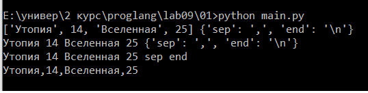
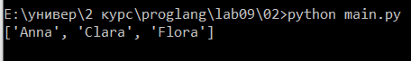
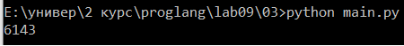
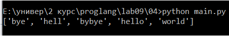
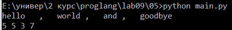
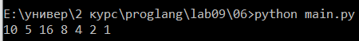
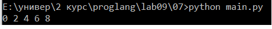
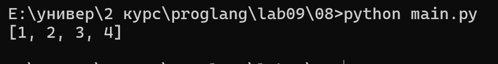
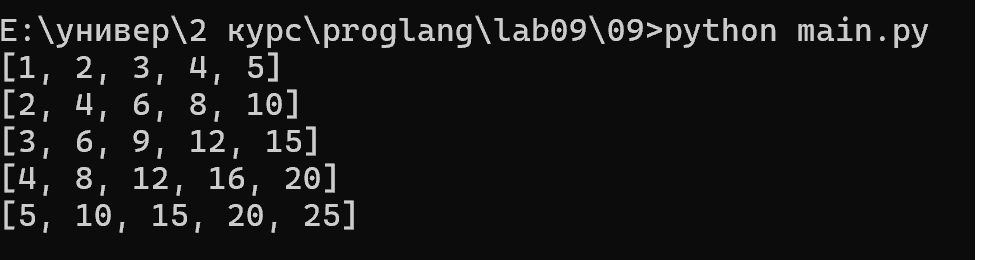

# Языки программирования
## Лабораторная работа 9

### Задание 1 **(2)**
*Рассмотрим следующую программу.*
```
d = {'sep': ',' , 'end': '\n'}
l = ['Утопия', 14, 'Вселенная', 25]
print (l, d)         выводит список и словарь целиком как два объекта со скобками и кавычками
print (*l, d)       *l  выводит список и словарь целиком как два объекта со скобками и кавычками
print (*l, *d)          *d распаковывает словарь, но берутся только ключи
print (*l, **d)           **d передаёт словарь как именованные аргументы sep=',' и end='\n'
```
*Объясните результаты ее работы.*

*При устном ответе на вопросы вам потребуется рассказать, что такое "Утопия 14" и "Вселенная 25".*

выполнив программу получим:



### Задание 2 **(2)**
*Напишите функцию* **sublist** для решения следующей задачи.*

*На вход функции поступает список или кортеж и набор номеров позиций.
Функция должна составить и вернуть список из элементов, которые
находятся на этих позициях. Примеры работы приводятся ниже. Работа функции должна строго им соответствовать.*

```
>>> lst = [ 'Anna', 'Barbara', 'Clara', 'Diana', 'Eva', 'Flora']
>>> sublist(lst, 0, 2, 5)
['Anna', 'Clara', 'Flora']
>>> sublist (lst)
[]
>>> sublist(lst, 0, 1, 2, 3, 4, 5)
['Anna', 'Barbara', 'Clara', 'Diana', 'Eva', 'Flora']
```
выполнив программу получим:



### Задание 3 **(1)**

*Задан список* **lst** *из натуральных чисел*. *Напишите фрагмент
программы, состоящий из одного вызова функции* **max**, *который найдет в этом списке число с максимальным
числом единиц в двоичной записи.* 

*Многоточие надо заменить на лямбда-функцию, использующую фукцию* **bin** *и метод строк* **count**.

*Пример работы приводится ниже.*
```
>>> lst = list(range(6000 ,7000))
>>> ans = max(lst,...)
>>> print(ans)
6143
```

программа в папке 03

выполнив программу получим:


### Задание 4 **(2)**

*Запишите фрагмент программы, которая упорядочит список слов
по длине, а при равенстве длины - лексикографически. Сортировка
должна состоять из одного вызова метода* **sort**.

*Пример работы приводится ниже.*

```
>>> lst = ['hello', 'hell', 'bye', 'world', 'bybye']
>>> lst.sort (...)
>>> print (lst)
['bye', 'hell', 'babye', 'hello', 'world']
```

программа в папке 04

выполнив программу получим:

### Задание 5 **(2)**

*Напишите программу для решения следующей задачи.*

*В одной строке через запятую записана последовательность слов. Перед
запятой или после нее могут быть пробелы, сами слова пробелов не
содержат. Программа должна вывести в одной строке через запятую
последовательность чисел, равных длине каждого слова. Например,
для ввода*
```
hello   ,   world ,   and ,   goodbye
```
*программа должна вывести*
```
5, 5, 3, 7
```
*Программа должна быть написана с использованием парадигмы функционального программирования, то есть без использования циклов, присваиваний и т.д. Программа может использовать функции* **input**, **print**, **len**, **map** *и методы строк* **split** и **strip**.

программа в папке 05

выполнив программу получим:


### Задание 6 **(2)**

*Запишите генератор в форме функции, который будет создавать
последовательность по следующему правилу.*

* *Если текущее число x в последовательности четное, то следующее число равно x/2.*
* *Иначе следующее число равно 3x + 1.* 

*Последовательность начинается с заданного числа n и заканчивается единицей.*

*Далее приведен пример работы генератора.*
```
>>> print (*gen(7))
7 22 11 34 17 52 26 13 40 20 10 5 16 8 4 2 1
```

программа в папке 06

выполнив программу получим:


### Задание 7 **(2)**

*Напишите генератор, который для заданной последовательности*
**seq** *будет задавать последовательность из каждого второго элемента* **seq**.

'''
def every_other ( seq )
    ...
'''
*Ниже приведены примеры использования генератра.*
```
>>> print (*every_other([10, 20, 30, 40, 50]))
10 30 50
>>> print(*every_other(range(10)))
0 2 4 6 8
>>> print(*every_other(iter(range(10))))
0 2 4 6 8
>>> print(sum(every_other(map(int, input().split()))))
2 5 11 3 8
21
```

программа в папке 07

выполнив программу получим:


### Задание 8 **(2)**

*Задан список* **lst**, *в котором записаны вперемешку числа и строки.*. 
*Напишите фрагмент программы, состоящий из одного конструктора списков, который построит новый список, состоящий только из чисел.* 

*Определить тип объекта в Python можно с использованием функции* **type**.

*Пример работы приводится ниже.*

```
>>> lst = [1,'abc', 2, 3, 4, 'aa']
>>> nums = [...]
>>> print(nums)
[1, 2, 3, 4]
```
программа в папке 08

выполнив программу получим:


###  Задание 9 **(2)**

*Напишите фрагмент программы, состоящий из одного конструктора списков, который построит двумерный список в виде таблицы умножения размера* 
**n×n**.

*Пример работы приводится ниже.*

```
>>> n = 5
>>> tblmul = [...]
>>> print(*tblmul,sep='\n')
[1, 2, 3, 4, 5]
[2, 4, 6, 8, 10]
[3, 6, 9, 12, 15]
[4, 8, 12, 16, 20]
[5, 10, 15, 20, 25]
```

программа в папке 09

выполнив программу получим:


###  Задание 10 **(1)**
*Какие из указанных функций и методов Python соответствуют определению чистых функций?
В случае отрицательного ответа требуется дать пояснение.*

* **file.readline|** — *чтение строки из файла.*       не чистая каждый вызов возращает разное
* **len** — *определение длины строки или количества элементов в контейнере.*   чистая
* **list.append** — *добавление в список нового элемента.*   не чистая изменяет сам список
* **sum** — *нахождение суммы.*   чистая
* **sorted** — *построение сортированного списка.*   чистая(строит новый список)
* **list.sort** — *сортировка списка.*    не чистая изменяет список
* **random.randint** — *генерация случайного целого числа.* не чистая разный результат при одинаковых аргументах
* *Разворот списка.*       чистая
```
def rev(x):
    return x[::-1]
```
* *Выбор нескольких элементов из хвоста списка.*  не чистая зависит от tail_len
```
tail_len = 3
def tail(x):
    return x[-tail_len:]
```

###  Задание 11 **(2)**
*Рассмотрите следующую функцию.*
```
def toint(fun):
    def wrapper(*args):
        return fun(*map(int, args))
    return wrapper
```
*Что передается в функцию* **toint**?
функция fun

*Что возвращает эта функция?*
функцию wrapper

*Что делает функция* **wrapper**?
принимает любое число аргументов превращает каждый в int и вызывает fun с результатами

*Придумайте несколько примеров использования* **toint**.

## Дополнительные задания

### Задание 1 **(3)**

*Самостоятельно познакомьтесь с понятием декораторов в Python. Приведите примеры использования
функции* **toint** *из задания выше в качестве декоратора.*


### Задание 2 **(3)**
*Напишите фрагмент программы, которая найдет в списке слов слово с максимальной длиной. При равенстве длин
найдет самое первое в лексикографическом порядке.*

*Фрагмент программы должен состоять из одного вызова функции* **min** *или* **max**.

### Задание 3 **(5)**

*Напишите рекурсивную функцию для нахождения* **n**-о *числа Фибоначчи.*

*Функция обязательно должна работать с достаточно большими числами, например* **n = 1000** *и не 
должна использовать библиотечные функции и методы.*

### Задание 4 **(9)**

*Напишите функцию* **fastpow**, *которая будет создавать лямбда-функцию для быстрого 
возведения в фиксированную степень* **n**. *Например, должен работать следующий код*
```
>>> pow10 = fastpow(10)
>>> print(pow10(2))
1024
```
*Функция* **fastpow** *в этом примере должна строить выражение для быстрого возведения в степень
по стандартному алгоритму* 
* **x^1 = x**;
* **x^{2n} = (x^n) ** 2**; 
* **x^{2n+1}=x*x^{2n}**;

*Например,
для* **n = 10** *может быть получена подобная строка* ```(x*((x**2)**2))**2```. 

*Далее* **fastpow** *будет возвращать лямбда функцию*
```
lambda x: eval(s)
```
*При написании функции* **fastpow** *можно использовать вспомогательные функции.*


